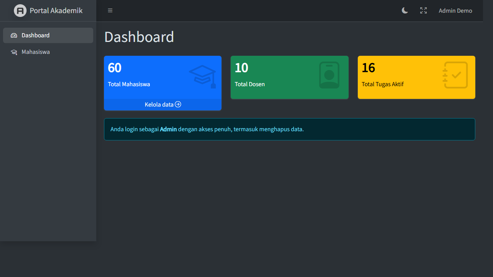

# Portal Akademik: Dashboard & RBAC

Tugas Mandiri PBKK Pertemuan 10. Panel admin AdminLTE dengan login Laravel Breeze dan otorisasi Spatie Laravel Permission.



## Instalasi

Butuh PHP 8.3+, Composer, dan Node.js.

```bash
composer run setup
php artisan serve
```

`composer run setup` memasang dependensi, membuat `.env` dan database SQLite, menjalankan migrasi beserta seeder, lalu mem-build aset. Buka `http://localhost:8000/login`.

Untuk mengulang data dari awal: `php artisan migrate:fresh --seed`.

## Akun Uji Coba (Auto-Login)

Di halaman login tersedia tombol **Login Admin** dan **Login Staf** (hanya tampil saat `APP_ENV=local`).

| Peran | Email | Password |
| --- | --- | --- |
| Admin | `admin@example.com` | `password` |
| Staf | `staf@example.com` | `password` |

## Hak Akses

Peran dan izin tersimpan di tabel Spatie (`roles`, `permissions`, `role_has_permissions`, dan lainnya).

| Izin | Admin | Staf |
| --- | --- | --- |
| `lihat-mahasiswa` | Ya | Ya |
| `tambah-mahasiswa` | Ya | Ya |
| `edit-mahasiswa` | Ya | Ya |
| `hapus-mahasiswa` | Ya | Tidak |

- Rute `/admin/*` dijaga middleware `auth`, `verified`, dan `role:Admin|Staf`.
- Tiap aksi di `MahasiswaController` dijaga middleware `permission:` (Laravel 13 memakai interface `HasMiddleware` sebagai pengganti `$this->middleware()` di constructor).
- Tombol Hapus hanya dirender lewat `@can('hapus-mahasiswa')`. Permintaan langsung dari Staf ke endpoint DELETE ditolak dengan 403.

## Spesifikasi Teknis Tugas


### 1. Integrasi UI Backoffice

Semua halaman admin mewarisi layout AdminLTE. Menu sidebar diatur terpusat di konfigurasi, dan menu Mahasiswa memakai filter izin `can`.

File: `/resources/views/admin/dashboard.blade.php` (juga `/resources/views/admin/mahasiswa/index.blade.php` dan `/resources/views/admin/mahasiswa/form.blade.php`)

```blade
@extends('adminlte::page')

@section('title', 'Dashboard')

@section('content_header')
    <h1>Dashboard</h1>
@endsection
```

File: `/config/adminlte.php`

```php
// Sidebar items:
[
    'text' => 'Dashboard',
    'route' => 'admin.dashboard',
    'icon' => 'bi bi-speedometer2',
],
[
    'text' => 'Mahasiswa',
    'route' => 'admin.mahasiswa.index',
    'icon' => 'bi bi-mortarboard',
    'can' => 'lihat-mahasiswa',
],
```

### 2. Sistem Autentikasi

Login, registrasi, dan verifikasi email memakai Laravel Breeze (`/routes/auth.php`, `/app/Http/Controllers/Auth/`, `/resources/views/auth/`). Seluruh rute `/admin` berada di bawah `auth` dan `verified`, sedangkan user tanpa peran yang membuka URL admin mendapat 403.

File: `/routes/web.php`

```php
Route::get('/dashboard', function (Request $request) {
    return to_route($request->user()->hasAnyRole(['Admin', 'Staf']) ? 'admin.dashboard' : 'home');
})->middleware(['auth', 'verified'])->name('dashboard');

Route::middleware(['auth', 'verified', 'role:Admin|Staf'])
    ->prefix('admin')
    ->name('admin.')
    ->group(function () {
        Route::get('/dashboard', DashboardController::class)->name('dashboard');
        Route::resource('mahasiswa', MahasiswaController::class)->except('show');
    });
```

Rute `/dashboard` adalah tujuan bawaan Breeze setelah login. Dari sana Admin dan Staf dialihkan ke panel admin, dan pengguna lain ke beranda publik.

File: `/app/Models/User.php`

```php
class User extends Authenticatable implements MustVerifyEmail
{
    /** @use HasFactory<UserFactory> */
    use HasFactory, HasRoles, Notifiable;
```

### 3. Otorisasi DB Spatie

Peran dan izin tersimpan di lima tabel Spatie: `roles`, `permissions`, `model_has_roles`, `model_has_permissions`, dan `role_has_permissions`. Tabelnya dibuat oleh `/database/migrations/2026_11_09_014622_create_permission_tables.php`.

File: `/database/seeders/RoleAndPermissionSeeder.php`

```php
$stafPermissions = ['lihat-mahasiswa', 'tambah-mahasiswa', 'edit-mahasiswa'];
$adminPermissions = [...$stafPermissions, 'hapus-mahasiswa'];

foreach ($adminPermissions as $permission) {
    Permission::firstOrCreate(['name' => $permission]);
}

Role::firstOrCreate(['name' => 'Admin'])->syncPermissions($adminPermissions);
Role::firstOrCreate(['name' => 'Staf'])->syncPermissions($stafPermissions);
```

### 4. Widget Dashboard Agregat

Tiga widget menampilkan total data langsung dari kueri `count()`. Tugas Aktif hanya menghitung tugas yang belum melewati tenggat.

File: `/app/Http/Controllers/Admin/DashboardController.php`

```php
return view('admin.dashboard', [
    'totalMahasiswa' => Mahasiswa::count(),
    'totalDosen' => Dosen::count(),
    'totalTugasAktif' => Tugas::whereDate('tenggat', '>=', today())->count(),
]);
```

File: `/resources/views/admin/dashboard.blade.php`

```blade
<x-adminlte-small-box :title="$totalMahasiswa" text="Total Mahasiswa" icon="bi bi-mortarboard" theme="primary"
    :url="route('admin.mahasiswa.index')" url-text="Kelola data" />
<x-adminlte-small-box :title="$totalDosen" text="Total Dosen" icon="bi bi-person-badge" theme="success" />
<x-adminlte-small-box :title="$totalTugasAktif" text="Total Tugas Aktif" icon="bi bi-journal-check" theme="warning" />
```

### 5. Pengaman Controller

`$this->middleware()` di constructor sudah tidak tersedia di Laravel 13, jadi middleware `permission:` dipasang lewat interface `HasMiddleware`, yaitu cara resmi versi ini untuk middleware di controller. Dengan begitu, Staf yang menembak endpoint DELETE secara manual tetap mendapat 403.

File: `/app/Http/Controllers/Admin/MahasiswaController.php`

```php
class MahasiswaController extends Controller implements HasMiddleware
{
    public static function middleware(): array
    {
        return [
            new Middleware('permission:lihat-mahasiswa', only: ['index']),
            new Middleware('permission:tambah-mahasiswa', only: ['create', 'store']),
            new Middleware('permission:edit-mahasiswa', only: ['edit', 'update']),
            new Middleware('permission:hapus-mahasiswa', only: ['destroy']),
        ];
    }
```

Alias middleware Spatie didaftarkan di `/bootstrap/app.php`:

```php
$middleware->alias([
    'role' => RoleMiddleware::class,
    'permission' => PermissionMiddleware::class,
]);
```

Tombol Hapus juga hanya dirender untuk pemegang izin tersebut.

File: `/resources/views/admin/mahasiswa/index.blade.php`

```blade
@can('hapus-mahasiswa')
    <form method="POST" action="{{ route('admin.mahasiswa.destroy', $mahasiswa) }}" class="d-inline"
        onsubmit="return confirm('Hapus data mahasiswa ini?')">
        @csrf
        @method('DELETE')
        <button type="submit" class="btn btn-sm btn-danger">Hapus</button>
    </form>
@endcan
```

## Tantangan Tambahan

### Filter Pencarian dan Kueri `when()`

Form di halaman tabel mencari berdasarkan nama atau NRP, serta menyaring departemen dan status. Status memakai `isset()` karena nilai `0` (Cuti) dianggap false oleh `when()`.

File: `/app/Http/Controllers/Admin/MahasiswaController.php`

```php
$mahasiswas = Mahasiswa::query()
    ->with('dosen')
    ->when($filters['search'] ?? null, fn (Builder $query, string $search) => $query->where(
        fn (Builder $query) => $query->where('nama', 'like', "%{$search}%")->orWhere('nrp', 'like', "%{$search}%")
    ))
    ->when($filters['departemen'] ?? null, fn (Builder $query, string $departemen) => $query->where('departemen', $departemen))
    ->when(isset($filters['status']), fn (Builder $query) => $query->where('is_active', $filters['status']))
    ->latest('id')
    ->paginate(10)
    ->withQueryString();
```

### Pengunci Link Pagination

`withQueryString()` pada kueri di atas menjaga filter tetap ada di link halaman berikutnya, misalnya `/admin/mahasiswa?search=a&status=1&page=2`.

File: `/resources/views/admin/mahasiswa/index.blade.php`

```blade
{{ $mahasiswas->links('pagination::bootstrap-5') }}
```

### Auto-Seeder Faker Realistis

`composer run setup` menjalankan `migrate --force --seed`, sehingga instalasi awal langsung terisi 60 mahasiswa, 10 dosen, 20 tugas, dan 2 akun demo. Nama dibuat dengan locale `id_ID`.

File: `/database/seeders/DatabaseSeeder.php`

```php
$this->call(RoleAndPermissionSeeder::class);

User::factory()->create(['name' => 'Admin Demo', 'email' => 'admin@example.com'])->assignRole('Admin');
User::factory()->create(['name' => 'Staf Demo', 'email' => 'staf@example.com'])->assignRole('Staf');

Mahasiswa::factory(60)->recycle(Dosen::factory(10)->create())->create();
Tugas::factory(20)->create();
```

File: `/database/factories/MahasiswaFactory.php` (juga `DosenFactory.php` dan `TugasFactory.php` di folder yang sama)

```php
return [
    'nrp' => fake()->unique()->numerify('5025######'),
    'nama' => fake('id_ID')->firstName().' '.fake('id_ID')->lastName(),
    'departemen' => fake()->randomElement(Mahasiswa::DEPARTEMEN),
    'dosen_id' => Dosen::factory(),
    'is_active' => fake()->boolean(85),
];
```

### Auto-Login Test Accounts

Tombol di halaman login mengisi lalu mengirim form login biasa, jadi tidak ada endpoint yang melewati pemeriksaan password. Tombolnya hanya tampil saat `APP_ENV=local`.

File: `/resources/views/auth/login.blade.php`

```blade
@env('local')
    <div class="mt-6 pt-4 border-t border-gray-200">
        <p class="text-sm text-gray-600 mb-2">Login instan untuk demo:</p>
        <div class="flex gap-2">
            @foreach (['Admin' => 'admin@example.com', 'Staf' => 'staf@example.com'] as $role => $email)
                <x-secondary-button onclick="this.form.email.value = '{{ $email }}'; this.form.password.value = 'password'; this.form.submit();">
                    Login {{ $role }}
                </x-secondary-button>
            @endforeach
        </div>
    </div>
@endenv
```

## Pengujian

```bash
php artisan test --compact
```
